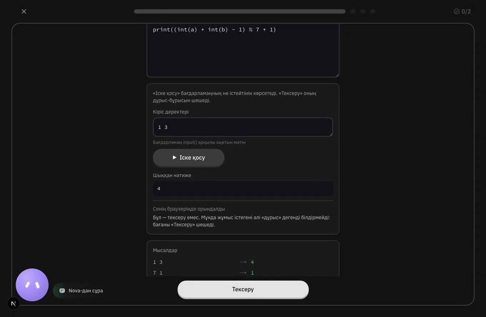

# SolveX4Schools

Билингвальная платформа для обучения девятиклассников спортивному программированию. Девятимесячная программа объединяет короткие объяснения, практику на Python, проверяемые задания, персональные подсказки Nova и инструменты учителя.

> Текущая ветка: `pilot-release-candidate`. Проект готовится к пилоту на один класс из 18 учеников.



## Что умеет платформа

- **Курс на девять месяцев.** Учебная программа разбита на месяцы, уроки, практику и итоговые проверки. Публикация контента и доступ ученика к следующему месяцу управляются отдельно.
- **Интерактивные уроки.** Теория, прогноз результата, трассировка, поиск ошибки, восстановление порядка, написание кода и развёрнутые ответы показываются по одному блоку за раз.
- **Запуск и проверка Python.** Кнопка «Запустить» выполняет код в браузере через Pyodide. «Проверить» отправляет решение доверенному серверному judge и не считает сбой инфраструктуры ошибкой ученика.
- **Nova.** ИИ-помощник выдаёт подсказки по ступеням, учитывает предыдущие попытки и не подменяет решение готовым ответом.
- **Learning Intelligence.** Событийный журнал хранит подтверждённые попытки, строит состояние навыков и отделяет самостоятельное решение от решения с помощью.
- **Кабинет учителя.** Список учеников, прогресс, навыки, проверки, письменные ответы и сигналы, требующие внимания человека.
- **Школьная модель доступа.** Школы, классы, учителя, ученики, одноразовые начальные пароли и обязательная смена пароля при первом входе.
- **Казахский и русский интерфейс.** Язык можно переключать без выхода из урока. Также поддерживаются светлая/тёмная тема и уменьшение анимации.

## Стек

- Next.js 16, React 19, TypeScript strict
- Tailwind CSS 4
- PostgreSQL в production, PGlite для локальной разработки
- Pyodide для локального запуска Python в браузере
- Judge0 или Piston для доверенной серверной проверки
- DeepSeek для Nova; локальный `echo`-провайдер для разработки
- Vitest и Playwright

## Быстрый запуск

### Требования

- Node.js 24+
- npm
- Python 3 для локальной серверной проверки решений

### 1. Установите зависимости

```bash
git clone https://github.com/L4RBIX/SolveX4schools.git
cd SolveX4schools
git switch pilot-release-candidate
npm ci
```

Репозиторий приватный: для клонирования нужен доступ к аккаунту владельца.

### 2. Создайте локальную конфигурацию

```bash
cp .env.example .env.local
```

Значения по умолчанию подходят для локальной разработки:

```dotenv
LEARNING_DATA_DIR=.data/learning
NOVA_PROVIDER=echo
EXEC_PROVIDER=local
EXEC_PYTHON_BIN=python3
```

Локально используется PGlite, поэтому отдельный PostgreSQL не обязателен. Секреты и `.env.local` не коммитятся.

### 3. Создайте тестовый класс

```bash
npm run school:provision -- \
  --school innovation-tech \
  --class grade-9a \
  --class-name "9А" \
  --teacher-name "Мұғалім" \
  --students 18
```

Команда сама применит недостающие миграции и один раз выведет логины с начальными паролями. Эти пароли нигде не сохраняются — не перенаправляйте вывод в файл внутри репозитория.

Добавьте идентификаторы класса в `.env.local`:

```dotenv
SCHOOL_ID=innovation-tech
CLASS_ID=grade-9a
```

### 4. Запустите приложение

```bash
npm run dev
```

Откройте [http://localhost:3000](http://localhost:3000). Подробности локальной разработки описаны в [docs/DEVELOPMENT.md](docs/DEVELOPMENT.md).

## Основные команды

| Команда | Назначение |
| --- | --- |
| `npm run dev` | Запустить dev-сервер на порту 3000 |
| `npm run build` | Собрать production-версию |
| `npm run start` | Запустить собранное приложение |
| `npm run lint` | Проверить ESLint |
| `npm run typecheck` | Проверить TypeScript |
| `npm run test` | Запустить тесты Vitest |
| `npm run test:python` | Запустить Python-тесты |
| `npm run curriculum:validate` | Проверить структуру и связи учебной программы |
| `npm run check` | Выполнить полный release gate |
| `npm run school:provision -- …` | Создать школу, класс и аккаунты |
| `npm run curriculum:publish -- …` | Опубликовать проверенный месяц |
| `npm run curriculum:unpublish -- …` | Снять месяц с публикации |
| `npm run db:verify-migrations` | Проверить миграции на чистой БД |

Полный `npm run check` выполняет lint, typecheck, проверки учебного контента, тесты, production build и проверку клиентского бандла на утечки секретов.

## Структура проекта

```text
src/app/                              страницы и API routes Next.js
src/components/                       интерфейс ученика, учителя и публичные страницы
schools/auth/                         аутентификация и сессии
schools/curriculum/                   программа, уроки, навыки и публикация
schools/exec/                         провайдеры выполнения и проверки кода
schools/learning/                     адаптер Learning Intelligence
schools/nova/                         политика подсказок и провайдер Nova
schools/store/                        хранилище, драйверы и миграции
schools/teacher/                      учительские проекции и review workflow
packages/learning-contracts/          контракты событий обучения
packages/learning-intelligence-core/  движок состояния и решений
packages/nova-core/                   общая логика Nova
tests/                                unit, integration и content-тесты
docs/                                 архитектура, эксплуатация, аудиты и runbooks
```

## Как устроена проверка кода

В проекте намеренно разделены два действия:

1. **Run** выполняет черновой код ученика в Pyodide прямо в браузере. Это быстро, не требует внешнего сервиса и не создаёт учебного доказательства.
2. **Submit** отправляет код на сервер, где Judge0 или Piston запускает его против скрытых тестов. Только этот результат может стать подтверждённым вердиктом.

Если judge недоступен, ответ остаётся *неизмеренным*: система не записывает инфраструктурный сбой как неправильное решение ученика. Подробнее: [docs/infrastructure/HYBRID_EXECUTION.md](docs/infrastructure/HYBRID_EXECUTION.md).

## База данных и прогресс

Локально приложение может работать с PGlite в `.data/learning`. Для совместной разработки и production используется PostgreSQL через `DATABASE_URL`.

Источник истины — append-only журнал учебных событий. Эпизоды, состояние навыков и учительские показатели являются восстанавливаемыми проекциями. Миграции применяются автоматически при открытии хранилища; отдельный ручной шаг перед обычным запуском не нужен.

Для локального PostgreSQL:

```bash
createdb solvex_dev
DATABASE_URL=postgres://localhost/solvex_dev npm run db:verify-migrations
```

Не направляйте разработку в базы `solvex_e2e` и `solvex_league_e2e`: тестовые сценарии очищают их. Подробности: [docs/DEVELOPMENT.md](docs/DEVELOPMENT.md#database).

## Production

Production-конфигурация fail-closed: приложение откажется запускаться, если отсутствуют обязательный секрет аттестации, постоянная база, ключ Nova или рабочий серверный judge.

Минимальный набор для пилотной конфигурации:

```dotenv
NODE_ENV=production
DATABASE_URL=postgres://…
LEARNING_ATTESTATION_SECRET=…
NOVA_PROVIDER=deepseek
DEEPSEEK_API_KEY=…
EXEC_PROVIDER=judge0_rapidapi
JUDGE0_RAPIDAPI_KEY=…
```

Ни один секрет не должен иметь префикс `NEXT_PUBLIC_`: такие значения Next.js встраивает в клиентский JavaScript. Полная таблица переменных и проверок находится в [docs/deployment/PRODUCTION_ENVIRONMENT.md](docs/deployment/PRODUCTION_ENVIRONMENT.md).

Проверка состояния deployment:

```bash
curl -s https://<host>/api/health | jq
```

Для ежедневной работы пилота используйте [docs/pilot/PILOT_RUNBOOK.md](docs/pilot/PILOT_RUNBOOK.md).

## Docker

Production-сборка:

```bash
docker compose up app --build
```

Dev-контейнер на порту `3001`:

```bash
docker compose up dev --build
```

## Документация

- [Локальная разработка](docs/DEVELOPMENT.md)
- [Production environment](docs/deployment/PRODUCTION_ENVIRONMENT.md)
- [Pilot runbook](docs/pilot/PILOT_RUNBOOK.md)
- [Архитектура Learning Intelligence](docs/integration/LI_ARCHITECTURE.md)
- [Гибридное выполнение Python](docs/infrastructure/HYBRID_EXECUTION.md)
- [Политика самостоятельного открытия месяцев](docs/releases/SELF_PACED_UNLOCK_POLICY.md)
- [Процедура публикации месяца](docs/releases/MONTHLY_PUBLICATION_PROCEDURE.md)
- [Метрики учителя](docs/teacher/TEACHER_METRICS.md)
- [Приватность Nova](docs/nova/PRIVACY.md)

## Безопасность

- Ключи провайдеров и строка подключения к БД доступны только серверу.
- Ответы и скрытые тесты не отправляются в клиентский бандл.
- Вердикты вычисляются на сервере и подписываются HMAC-аттестацией.
- Ученический исходный код не записывается в payload событий обучения.
- Письменные объяснения не оцениваются моделью автоматически и остаются на проверку учителю.
- `npm run check:bundle` проверяет production-бандл на утечки секретов.

## Лицензия

Код распространяется по лицензии [MIT](LICENSE). Права на отдельные сторонние ассеты и их происхождение перечислены в [docs/THIRD_PARTY_ASSETS.md](docs/THIRD_PARTY_ASSETS.md).
